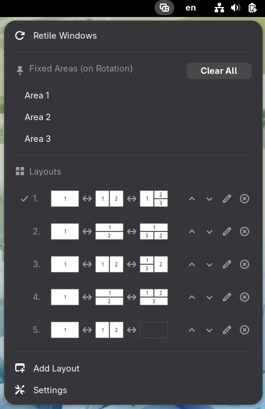
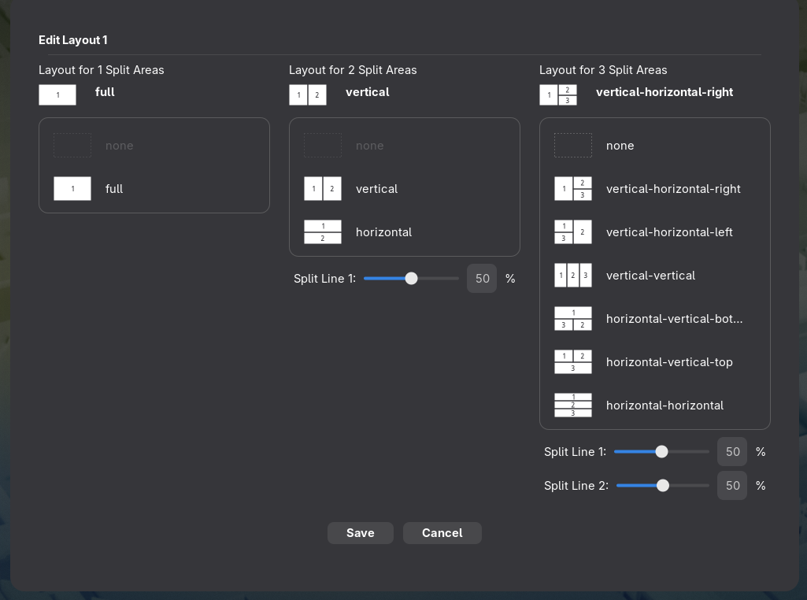
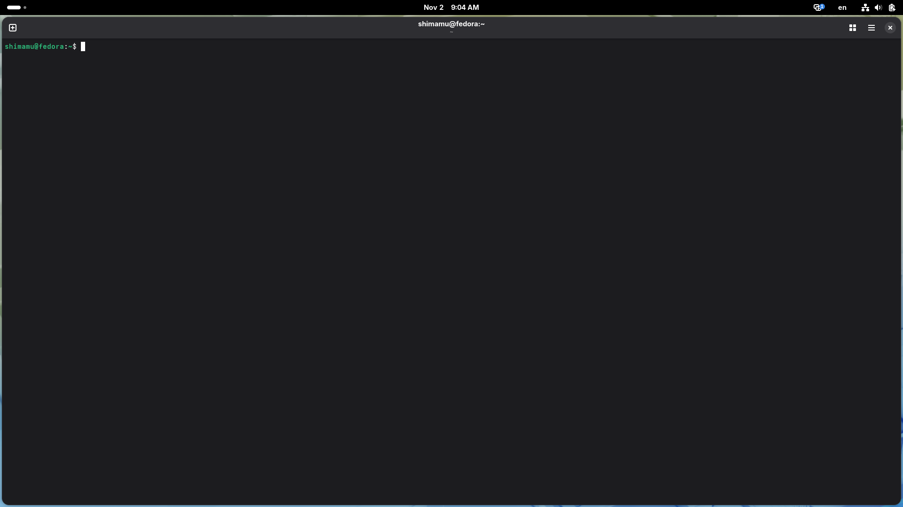
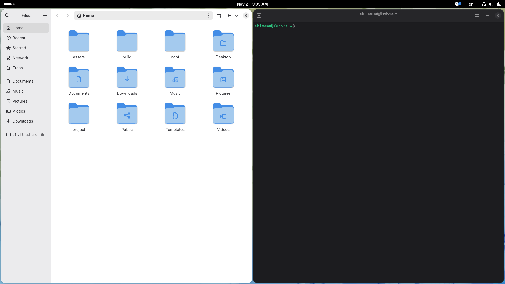
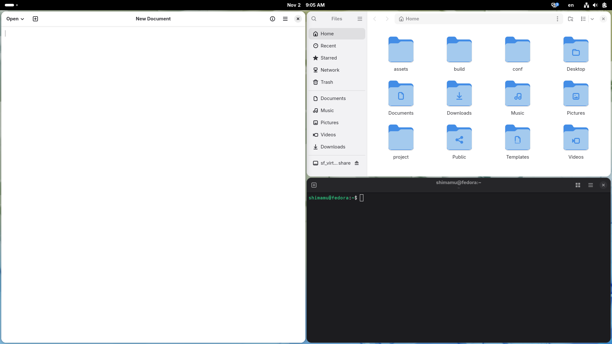
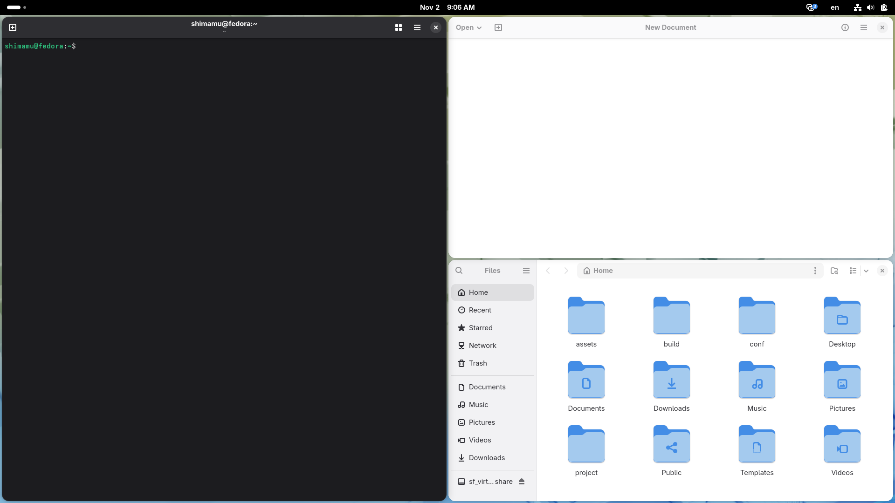
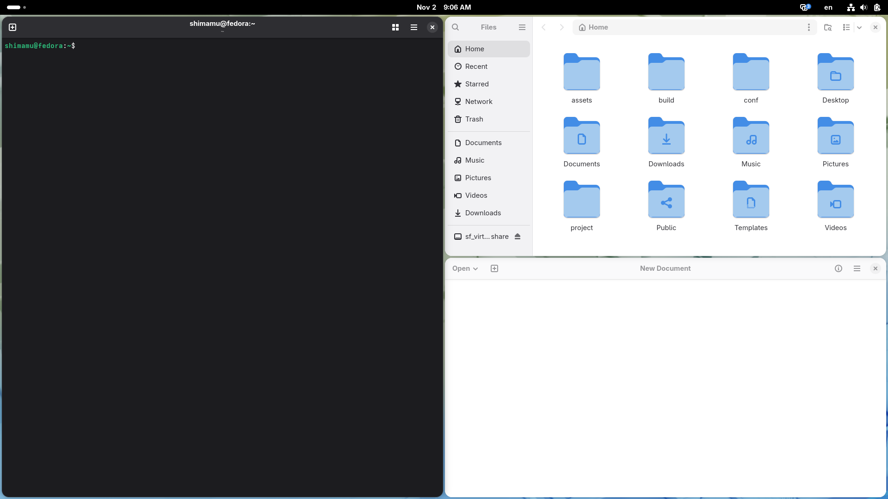
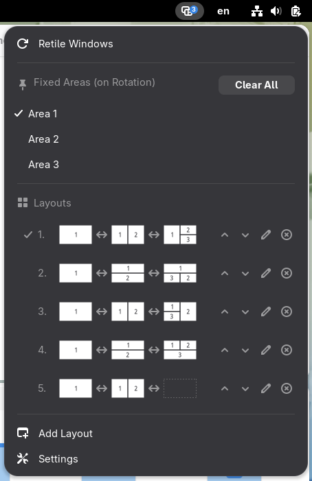

# gnome-switch-layout-tiling

A GNOME Shell extension that automatically tiles windows using predefined layouts and allows you to switch between layouts.

## Overview

`gnome-switch-layout-tiling` is a GNOME Shell extension that arranges windows in predefined tiling layouts. It provides multiple layout patterns and allows you to cycle through them to find the arrangement that best fits your workflow.

## Features

- Automatically tiles windows according to the selected layout
- Supports multiple layout patterns, including:
  - Full
  - Vertical
  - Horizontal
  - Half
  - Half then Half
  - Three Equal
- Supports multiple layout maps with customizable split areas
- Switches between layouts using mouse wheel scrolling
  - Scroll down: Clockwise
  - Scroll up: Counterclockwise
- Supports workspace-specific layout settings
- Configurable window margins
- Supports up to 50 layout maps

## Screenshots

### Indicator Menu

The indicator menu allows you to switch between layout maps
and configure fixed split areas.



### Layout Map Editor

The Layout Map Editor allows you to configure split areas
for each layout map.



### Split Areas

The extension supports layouts with different numbers of split areas.

| One Split Area | Two Split Areas | Three Split Areas |
| --- | --- | --- |
|  |  |  |

### Switching Layouts

Scroll down to switch to the next layout in clockwise order.

The following screenshots show how the window arrangement changes
when switching layouts.

| Initial Layout | Scrolled | Scrolled with Area 1 Fixed |
| --- | --- | --- |
|  |  |  |

You can fix individual split areas to keep their positions
when switching layouts.

### Fixed Split Areas

You can select a split area from the indicator menu to fix its position
when switching layouts.




## Installation

### From GNOME Extensions Website (Recommended)

You can install the extension directly from the official GNOME Extensions website:

<!-- Add GNOME Extensions link when published -->

Steps:

1. Visit the extension page in a browser that has the GNOME Shell integration extension installed.
2. Toggle the switch to "On" to install.
3. Approve the installation when prompted.
4. The extension will be enabled automatically.

Your system will also handle future updates automatically.

### From Source (Manual Installation)

1. Clone this repository:

   ```bash
   git clone https://github.com/shimamu/gnome-switch-layout-tiling.git
   cd gnome-switch-layout-tiling
   ```

2. Build and install the extension:

   ```bash
   make install-build
   ```

3. Enable the extension:

   ```bash
   gnome-extensions enable switch-layout-tiling@shimamu.github.com
   ```

4. Restart GNOME Shell:
   - On X11: Press `Alt` + `F2`, type `r`, then press `Enter`.
   - On Wayland: Log out and log back in.

## Compatibility

| Extension Version | GNOME Shell Version |
| --- | --- |
| v1.0 | 48, 49, 50 |

## Requirements

- GNOME Shell 48 or later

## Configuration

The extension provides settings for customizing layout maps and window arrangement.

Available settings include:

- Layout maps: Configure the layout patterns and split areas.
- Workspace settings: Associate layout maps with individual workspaces.
- Window margin: Adjust the spacing around tiled windows.

## License

This project is licensed under the GNU General Public License v3.0 or later. See [LICENSE](LICENSE) for details.

## Development / Maintenance

For maintainers or future contributors:

- The GNOME Shell extension ZIP package is automatically built by GitHub Actions when a tag matching `v*` is created.
- The `Makefile` provides targets for compiling schemas, compiling translations, installing the extension, and running tests.
- Unit tests are written using Vitest.

For details, see the workflow configuration file: [`.github/workflows/build.yml`](.github/workflows/build.yml).

